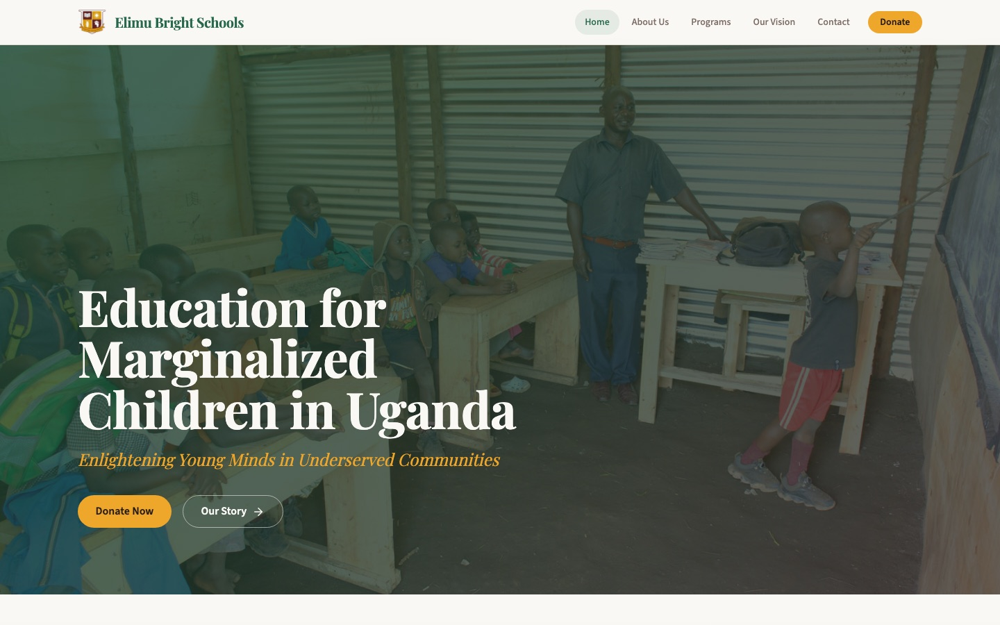
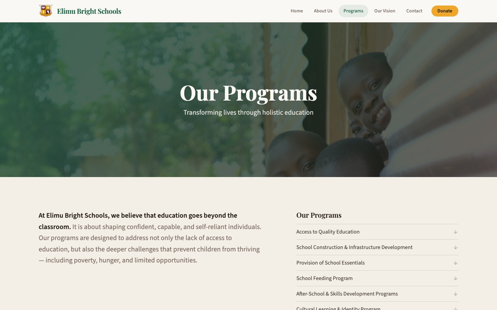
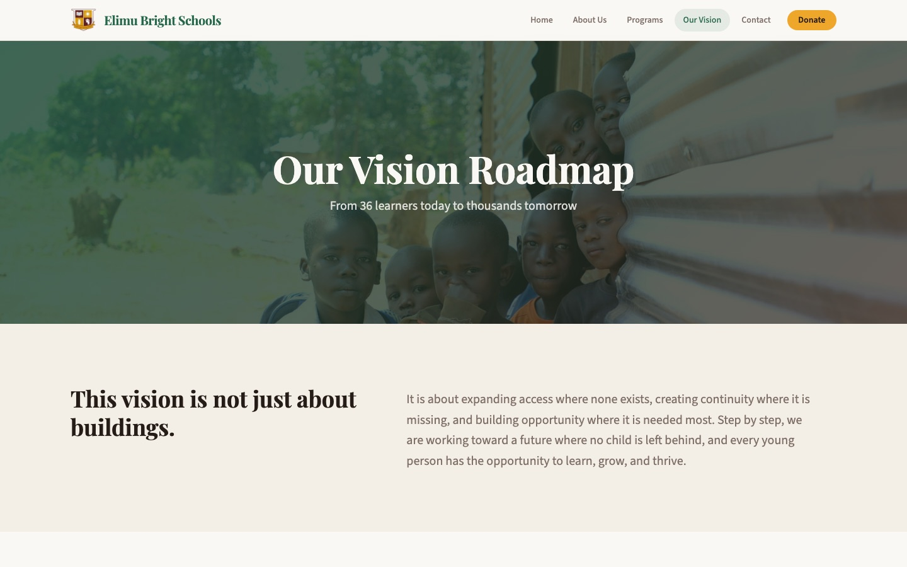
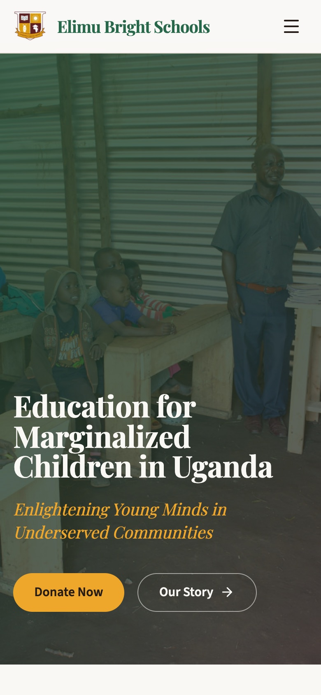
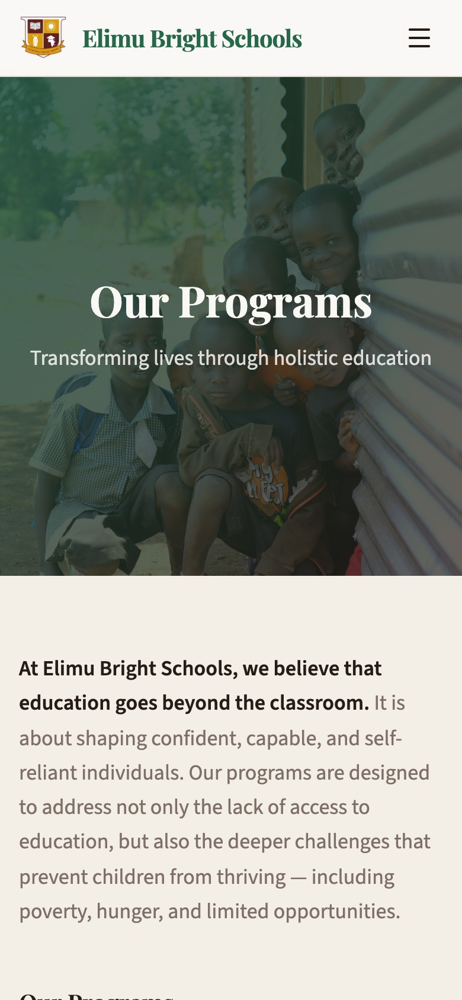

# Elimu Bright Schools

Website for **Elimu Bright Schools**, a school founded by young refugee leaders in Kabaale Sub-county, Hoima District, Uganda, for children who otherwise have no classroom. The site tells the school's story, describes its programs and growth roadmap, and directs supporters to donate.

**Live site:** https://elimubrightschools.org



<table>
  <tr>
    <td width="50%"></td>
    <td width="50%"></td>
  </tr>
  <tr>
    <td align="center">Programs</td>
    <td align="center">Roadmap</td>
  </tr>
</table>

<table>
  <tr>
    <td align="center"><br>Home on a phone</td>
    <td align="center"><br>Programs on a phone</td>
  </tr>
</table>

## Who it's for

- **Donors and sponsors**, mostly international, who want to fund classrooms, supplies and school feeding
- **Partner organizations** evaluating the school's programs and roadmap
- **The local community** in Hoima District

## My role

I built and deployed the website: page structure, React front end, the donation flow, SEO and Netlify hosting, working from content supplied by the school's founders.

## Pages

| Route       | Content                                                     |
| ----------- | ----------------------------------------------------------- |
| `/`         | Mission, impact numbers, call to donate                     |
| `/about`    | Founding story and management team                          |
| `/programs` | Education, school feeding, mentorship, community programs   |
| `/roadmap`  | Growth plan, from the first cohort of 36 learners onward    |
| `/donate`   | Donation options, including a GoFundMe widget                |
| `/contact`  | Contact details                                             |

## Tech stack

| Layer      | Choice                                             |
| ---------- | -------------------------------------------------- |
| Framework  | React 19 + TypeScript                              |
| Build tool | Vite 8                                             |
| Routing    | React Router 7                                     |
| Styling    | Tailwind CSS 4 + shadcn/ui primitives (Radix)      |
| Testing    | Vitest 5, Testing Library, jsdom                   |
| Hosting    | Netlify (auto-deploys from `main`)                 |
| CI         | GitHub Actions: lint, typecheck, test, build       |

## Architecture

The site is a static single-page app with no backend. `public/_redirects` sends every path to `index.html` for client-side routing, and donations are handled by GoFundMe in an embedded widget.

```
src/
  App.tsx              Routes, wrapped in a shared Layout (Navbar + Footer)
  pages/               One component per route
  components/          Navbar, Footer, Layout, PageHero, ui/ (shadcn)
  test/setup.ts        jest-dom and matchMedia stub
  App.test.tsx         Route and navigation smoke tests
public/
  pics/                Photos used across the site
  _redirects           SPA fallback for Netlify
```

## Local setup

Requires Node.js 22.12+ (Vitest 5 requirement; see `.nvmrc`) and npm.

```bash
git clone https://github.com/anujmish1229/Elimu-Bright-Schools.git
cd Elimu-Bright-Schools
npm install
npm run dev        # http://localhost:8080
```

| Script              | What it does                   |
| ------------------- | ------------------------------ |
| `npm run dev`       | Vite dev server                |
| `npm run build`     | Production build into `dist/`  |
| `npm test`          | Run the test suite             |
| `npm run lint`      | ESLint                         |
| `npm run typecheck` | TypeScript type check          |

## Environment variables

None.
